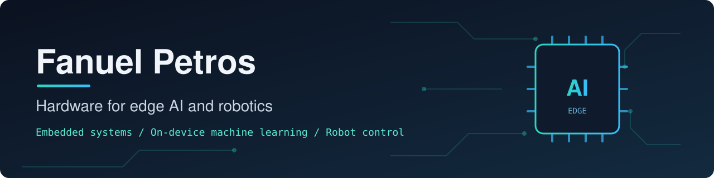
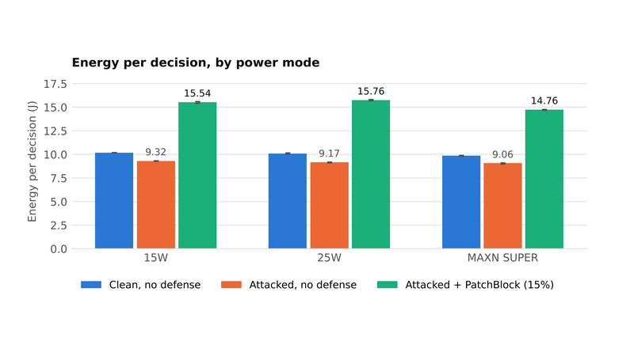
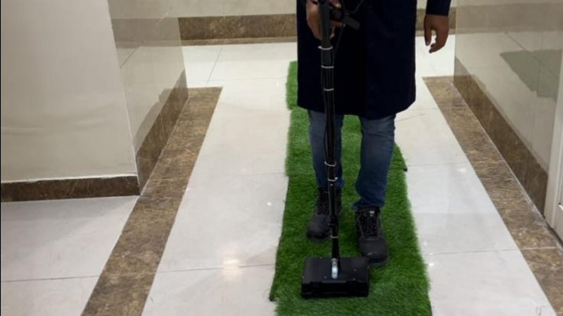
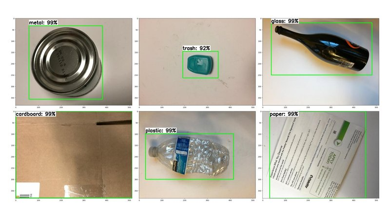
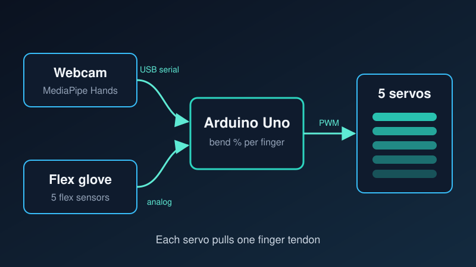

  

## About me

I am an electrical engineer. I work where AI meets hardware.

- **I build the hardware that AI systems run on.** Sensors, signal chains and
  microcontrollers that capture clean data and feed it to a model.
- **I build and run edge AI.** I train models, convert them for small devices,
  and run them on the device itself: NVIDIA Jetson, Raspberry Pi and
  microcontrollers. Then I measure how fast they run and how much energy they
  use.
- **I build hardware for robotics.** Actuators, sensors and controllers for
  machines that move, from a five-finger robotic hand to a pneumatic sorter on
  a conveyor.

BSc in Electrical Engineering, Higher Colleges of Technology, UAE.
Concentration in electronics and embedded systems.

## What I work on

<table>
  <tr>
    <td width="33%" valign="top">
      <h3>Hardware for AI</h3>
      Microphones over I2S, cameras and sensors wired to STM32, Arduino and
      Raspberry Pi. Filtering on the microcontroller, so the model gets a
      clean signal.
        
      <b>Example:</b> an NLMS noise filter on an STM32 that cleans audio
      before a classifier hears it.
    </td>
    <td width="33%" valign="top">
      <h3>Edge AI</h3>
      Training in PyTorch, TensorFlow and Edge Impulse, then deployment with
      TensorFlow Lite on Jetson and Raspberry Pi. Results are measured on
      the target device.
        
      <b>Example:</b> energy per decision of a vision-language agent on a
      Jetson Orin Nano, across three power modes.
    </td>
    <td width="33%" valign="top">
      <h3>Robotics hardware</h3>
      Servos, pneumatic actuators, motor drivers and feedback sensors, with
      the control code that ties them to a vision or sensor input.
        
      <b>Example:</b> a robotic hand that copies finger movement from a
      webcam or a flex sensor glove.
    </td>
  </tr>
</table>

## Featured projects

<table>
  <tr>
    <td width="50%" valign="top">
      
      <h3><a href="https://github.com/Fanuelpeter007/patchblock-vlm-jetson">PatchBlock on Jetson</a></h3>
      Runs the PatchBlock adversarial patch defense in front of a SmolVLM
      agent and measures its energy and latency cost on a Jetson Orin Nano.
        
      <code>Jetson Orin Nano</code> <code>PyTorch</code> <code>SmolVLM</code> <code>energy measurement</code>
    </td>
    <td width="50%" valign="top">
      
      <h3><a href="https://github.com/Fanuelpeter007/Underground-Cable-Fault-Locating">Underground Cable Fault Locator</a></h3>
      Finds the sound of a cable fault through background noise. NLMS noise
      cancelling on an STM32 and an audio classifier on a Raspberry Pi.
        
      <code>STM32</code> <code>I2S</code> <code>NLMS</code> <code>Edge Impulse</code> <code>Raspberry Pi</code>
    </td>
  </tr>
  <tr>
    <td width="50%" valign="top">
      
      <h3><a href="https://github.com/Fanuelpeter007/Waste-Sorting">Waste Sorting</a></h3>
      Conveyor sorter on a Raspberry Pi 5. A TensorFlow Lite model classifies
      each item and a pneumatic actuator pushes it into its bin.
        
      <code>Raspberry Pi 5</code> <code>TensorFlow Lite</code> <code>OpenCV</code> <code>GPIO</code> <code>pneumatics</code>
    </td>
    <td width="50%" valign="top">
      
      <h3><a href="https://github.com/Fanuelpeter007/Hand-Tracking-Robotic-Hand">Hand-Tracking Robotic Hand</a></h3>
      Robotic hand that copies human finger movement, driven by MediaPipe
      hand tracking or a flex sensor glove.
        
      <code>Arduino</code> <code>MediaPipe</code> <code>OpenCV</code> <code>servos</code> <code>flex sensors</code>
    </td>
  </tr>
</table>

## Toolbox

| Area | Tools |
|---|---|
| Edge AI | PyTorch, TensorFlow, TensorFlow Lite, Edge Impulse, MediaPipe, OpenCV |
| Edge hardware | NVIDIA Jetson Orin Nano, Raspberry Pi 5, STM32, Arduino |
| Embedded | C, C++, STM32 HAL, I2S, GPIO, PWM, ADC |
| Signal processing | MATLAB, adaptive filters (LMS, NLMS), MFCC audio features |
| Robotics and electronics | Servos, pneumatic actuators, motor drivers, sensors, PCB design |
| Languages | Python, C, C++, MATLAB |

## How I work

1. **Build it on real hardware.** A result only counts once it runs on the device it is meant for.
2. **Measure it.** Latency, energy and accuracy on the target device, with the numbers written down.
3. **Report it honestly.** What worked, what did not, and the limits of each result.
